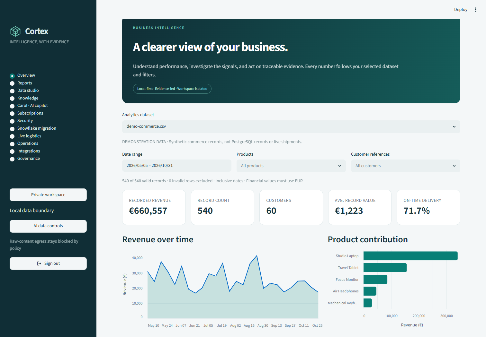
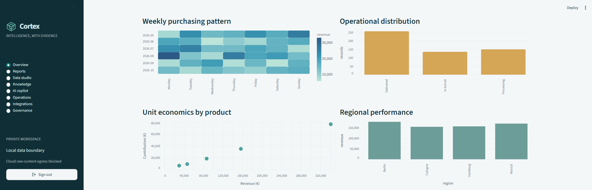
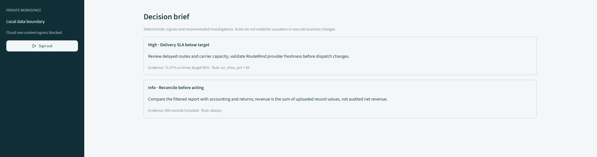
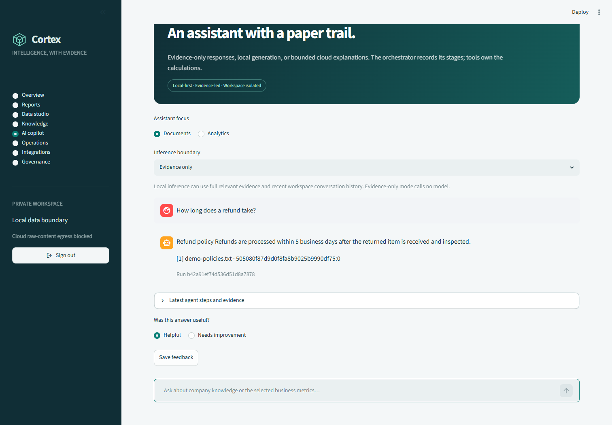
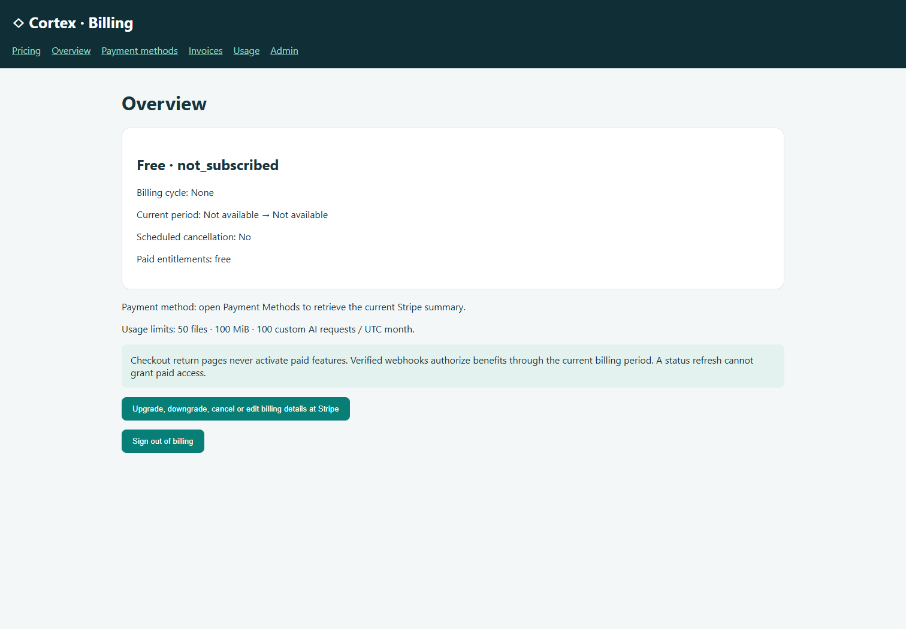
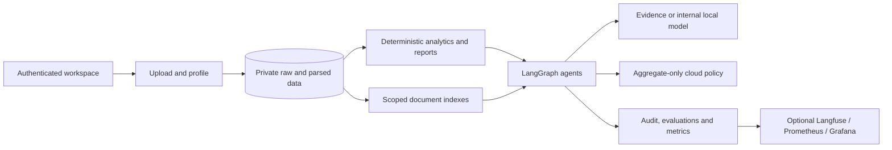

# Cortex — Enterprise Intelligence Workspace

A local-first workspace for business analytics, document retrieval and auditable AI decision support. Upload data once, inspect its quality, choose a retrieval configuration, and explore traceable numbers and evidence.

**Release status:** enterprise-oriented single-node foundation. Authentication and account isolation are implemented; public multi-tenant SaaS hardening is still required. See [remaining work](docs/REMAINING_WORK.md).

## What changed

| Before | Workspace release |
|---|---|
| Three unauthenticated pages over shared data | Signup/login and private per-account datasets/history |
| Fixed PostgreSQL charts | Raw uploads, eight chart views, date/product/customer filters and reports |
| Shared Pinecone RAG | Local scoped BM25, parent-child and optional local dense hybrid indexes |
| Single question-answer function | Actual LangGraph policy/tool/response/verification workflow |
| Aspirational enterprise feature list | Explicit implemented, optional and pending capabilities |
| No visible data boundary | Local full-content inference; cloud numeric aggregates only |

## Subscription billing

The Stripe increment adds authenticated billing pages, monthly/annual plan checkout, hosted card management, safe saved-card summaries, invoices/PDF links, usage allowances and an administrator dashboard with password re-verification. Signed webhooks authorize paid allowances; checkout redirects never do. **Stripe keys/products are not configured here; no real test payment has been performed.**

Run the companion service on port 8503 and follow the [Stripe setup and payment verification guide](docs/STRIPE_BILLING.md). It documents exact routes, configuration, database migrations, test coverage and remaining production requirements. No final commercial prices are hardcoded.

## Workspace capabilities

New modules: **Subscriptions (Stripe)**, **Security**, **Snowflake migration**, **Live logistics**, and **Carol** with FAQs/custom queries. Uploads now require a local ClamAV scan and split files at least 10 MiB into parts up to 9 MiB. Langfuse/DeepEval have separate installation, configuration and runtime controls. See the [module activation guide](docs/MODULES_GUIDE.md) for exact behavior, service requirements and privacy boundaries.

- **Accounts:** salted PBKDF2 passwords, login throttling, expiring sessions and signout. Each account starts empty.
- **Data studio:** CSV, flat JSON, XLSX, PDF and TXT; bounded parsing, source fingerprints, immutable raw versions, quality profiles, explainable recommendations and optional local AI advice from a bounded sample.
- **Analytics:** revenue trend, product contribution, revenue mix, customer concentration, weekly heatmap, operational distribution, contribution economics and regional performance. All use the same selected date/product/customer filters.
- **Reports:** grouped and underlying tables, CSV exports with spreadsheet formula escaping. Required schema: `date,product,customer_id,revenue`; single currency EUR.
- **Decision brief:** deterministic SLA, contribution-margin and concentration rules with evidence and suggested investigations.
- **Knowledge:** scoped indexes, source/chunk references, no-evidence abstention and retrieval smoke tests. Hybrid uses local dense embeddings + BM25/RRF, with lexical coverage reranking; neural reranking is not yet implemented.
- **Copilot:** evidence-only default, optional LangChain/Ollama generation with recent private history, or Groq explanations of approved numeric aggregates only.
- **Operations:** index lifecycle events, agent runs, duration/status, private chat history and feedback. Optional metadata-only Langfuse, deterministic DeepEval metric and Grafana/Prometheus configuration.
- **Connections:** administrator-only read adapter for [RouteMind](https://github.com/HamzaAhmedKhan786/agentic-logistics-ai); contract-based market gateway. No connected service is represented as live unless configured and fetched.

## Screenshots

Fresh workspace screenshots are in [docs/screenshots](docs/screenshots). The capture guide identifies synthetic demonstration data and validation limits.











## Quick start

Python 3.12:

```powershell
python -m venv .venv
.\.venv\Scripts\Activate.ps1
pip install -r requirements-enterprise.txt
Copy-Item .env.example .env
streamlit run app/streamlit_app.py
```

Open http://localhost:8501 and create an account. No default passwords or seeded user accounts exist. Select **Load demonstration workspace** to explore 540 explicitly synthetic records; these are separate from the original PostgreSQL sample data.

```powershell
# Docker workspace uses a separate port to avoid the local Python server:
docker compose -f docker/docker-compose.yml up --build -d streamlit
# Open http://localhost:8502
```

For the optional monitoring profile, set a strong `GRAFANA_ADMIN_PASSWORD` in `.env` first, then run:

```powershell
docker compose --env-file .env -f docker/docker-compose.yml --profile observability up -d
```

Grafana: localhost:3001. Prometheus: localhost:9095. Docker data persists in a named volume. Do not remove volumes unless you intend to delete the workspace.

## Privacy by execution path

| Mode | Data sent to AI |
|---|---|
| Evidence only | Nothing; no model call |
| Internal Ollama | Full relevant evidence and recent workspace conversation history |
| Cloud aggregates | Allowlisted finite numeric totals and a fixed task only; no names, addresses, bank details, identifiers, labels, documents or user questions |

Cloud analysis requires at least 10 records and 5 customers. Cloud document RAG is blocked; automatic redaction alone is not treated as a reliable privacy boundary. Automatic legacy LangSmith prompt tracing is disabled on the new workflow. Optional Langfuse exports anonymous run metadata only. Operators must secure storage/backups and review provider contracts. See the [privacy notice](docs/PRIVACY_POLICY.md).

## Optional model and integration setup

Local generation needs an already provisioned Ollama model and `OLLAMA_HOST`/`OLLAMA_MODEL`. Dense hybrid needs the optional Sentence Transformers dependencies and a cached `sentence-transformers/all-MiniLM-L6-v2` model; indexing never downloads one automatically. Original Pinecone/ETL dependencies remain in `requirements.txt`.

Optional Langfuse/DeepEval packages are in `requirements-observability.txt`; installation does not enable telemetry. Configure providers explicitly and verify SDK/server compatibility. No cloud judge is used by the custom citation metric.

RouteMind's inspected API exposes plans, health and events, not carrier shipment tracking. Configure `LOGISTICS_BASE_URL` and `CORTEX_ADMIN_USER_ID` to enable read-only plan snapshots. Location/traffic may still be simulated upstream. A real carrier feed and tenant authorization are future work. Market intelligence requires an operator-supplied licensed provider/gateway; no fabricated market figures are shown.

## Tests

```powershell
pip install -r requirements-dev.txt
python -m pytest tests -q --cov=cortex --cov-report=xml
```

Coverage includes accounts/lockout, workspace isolation, indexing, cloud payload policy, filtered calculations, export safety, real LangGraph persistence and UI flows. See [validation](docs/VALIDATION.md) for what actually ran in this release.

## Architecture



## Documentation

- [Product requirements and before/after scope](docs/PRD.md)
- [Architecture](docs/ARCHITECTURE.md) and [system design](docs/SYSTEM_DESIGN.md)
- [User/operator guide](docs/USER_GUIDE.md)
- [New modules, agents and activation guide](docs/MODULES_GUIDE.md)
- [Privacy policy template](docs/PRIVACY_POLICY.md)
- [Production backlog](docs/REMAINING_WORK.md) and [validation](docs/VALIDATION.md)

## Important scope boundaries

SQLite persistence and per-account workspaces are implemented; organizations/RBAC, SSO/MFA, password recovery, encrypted object storage, durable ingestion workers and security certification are not. Indexing is synchronous. AI strategy advice is provisional, not an automatic benchmark winner. GraphRAG, contextual enrichment, neural reranking, full Snowflake ingestion and Cortex Analyst/Search integration remain pending. Kafka/RabbitMQ are not required for the current bounded workflow and are not added speculatively.

The original app remains at `app/legacy_streamlit_app.py` with the legacy PostgreSQL/Pinecone path. It has no new account boundary: use it only in a private development environment. Existing Kubernetes and n8n files are legacy templates and are not validated deployment instructions for this workspace release. dbt project configuration and missing orders model are supplied; warehouse execution requires separate credentials and loading setup.

Author: Hamza Ahmed Khan
