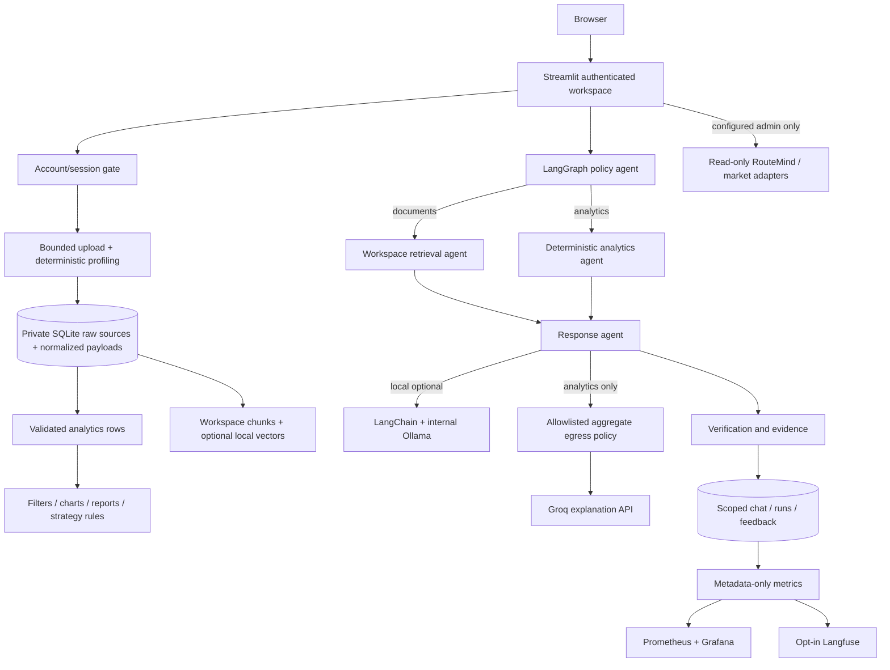

# Architecture

## Current executable design

`cortex/store.py` owns authentication and persistence. `data.py` owns ingestion and calculations. `retrieval.py` owns indexes. `agents.py` compiles the actual LangGraph and invokes LangChain only for local generation. `privacy.py` validates every cloud explanation input. `integrations.py` calls only operator-configured endpoints and projects numeric fields out of upstream logistics responses.

No database query is generated or executed by an LLM. Analytics uses validated DataFrames and fixed aggregations. Retrieval has no write-capable tool. The graph has a bounded recursion limit. An AI explanation cannot approve a shipment change or alter source records.

## Storage and tenant boundary

SQLite supports one local application deployment with concurrent short transactions; it is not the intended horizontal-scale persistence layer. Raw bytes, parsed payloads and indexes are scoped through `datasets.owner`. Chunk reads join datasets before applying account ownership. Chat, events, feedback and runs are independently scoped. Changing the file content creates a new dataset ID; duplicate content in the same account returns the existing ID.

Files are not sent to shared Pinecone by the new workspace app. The prior PostgreSQL and Pinecone implementation is preserved in `app/legacy_streamlit_app.py` for development only. It bypasses new auth controls and must never be publicly deployed.

## AI and privacy boundaries

The default is evidence-only, with no LLM calls. Local generation uses approved loopback/internal Ollama hosts; it may process document content and recent history. Embeddings require an already cached local MiniLM model. No automatic model downloads occur while indexing.

Cloud generation sees only `records`, `revenue`, `customers`, `products`, `average_record_value`, `margin_pct`, `on_time_pct`. Payloads reject unknown fields, strings, nonfinite values and small cohorts. Product/customer labels and user questions are excluded entirely. Small-group thresholds reduce risk but are not a differential-privacy guarantee.

Legacy LangSmith auto-tracing is disabled on the new agent path. No prompt-capturing LangChain callbacks are attached. Langfuse receives anonymous run IDs, route, status and duration only. Metrics have no customer-level labels.

## Deployment and future architecture

### Connected module agents

`module_agents.py` supplies SubscriptionAgent, SecurityAgent, MigrationAgent, LogisticsAgent, UploadAgent, CarolAgent and ObservabilityAgent. Each compiles a LangGraph authorization/tool workflow and records only metadata. Webhooks enter a separate narrow FastAPI service at `/webhooks/stripe` and use Stripe signature verification, customer binding, event deduplication and authoritative subscription re-fetching. Migration credentials are operator-scoped and administrator-only. Logistics access is constrained by stored workspace assignments. Uploads scan the complete stream through local ClamD before deep parsing/splitting; unavailable scans fail closed. Carol uses trusted FAQ responses or delegates to the existing evidence/analytics graph. See `MODULES_GUIDE.md` for protocols, readiness and deployment profiles.

Docker serves the workspace on localhost:8502, separate from the local Python server on 8501. Named-volume data persists across restarts. An optional observability profile adds metrics, Prometheus and Grafana. The app runs as a non-root user and the build context excludes environment files and private storage.

For production: TLS reverse proxy, OIDC, organization membership/RBAC, PostgreSQL row-level security, encrypted object storage, network egress policy, private inference, asynchronous ingestion workers, deletion lifecycle and audited migrations. Use RabbitMQ for task dispatch or Kafka for replayable domain event streams only when those requirements exist; neither is required for this bounded release.

Snowflake/dbt remain a separate warehouse path. dbt project configuration and the missing orders model are supplied; Snowflake credentials, staging/loading and cloud execution remain operator work. Existing Kubernetes manifests are legacy templates and are not a deployment definition for this new stateful release.
